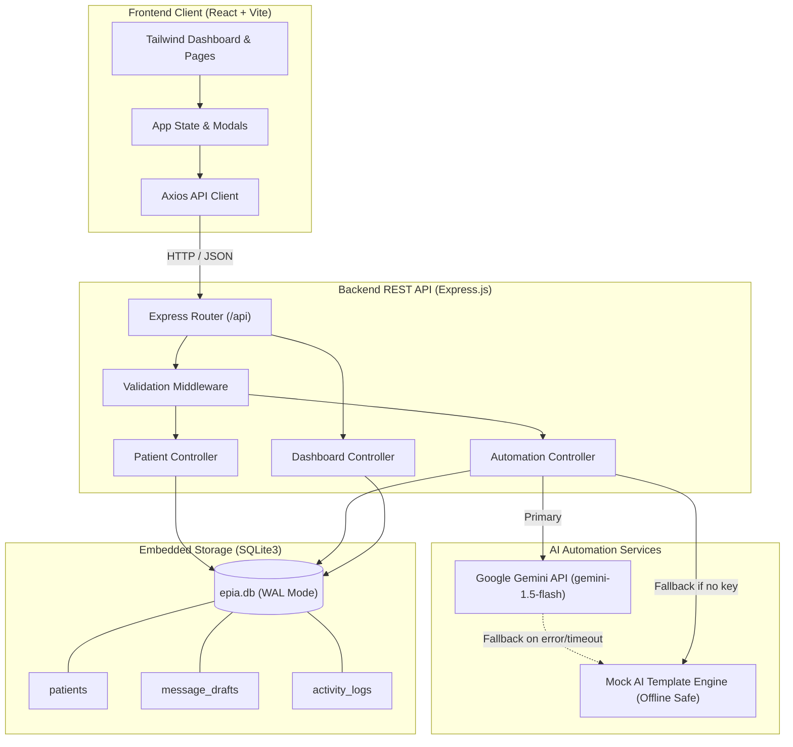

# EPIA Patient Follow-Up Automation System

[](https://nodejs.org)
[](https://expressjs.com)
[](https://react.dev)
[](https://github.com/WiseLibs/better-sqlite3)
[](https://ai.google.dev/)
[](#human-in-the-loop-guarantee)

> **Production-Quality Technical Assessment Solution**  
> **Role:** EPIA Technical Assessment – Backend & AI Automation Internship  
> **Objective:** Deliver an end-to-end, fully functional, human-supervised patient follow-up automation system for a fictional healthcare clinic.

---

## 📋 Table of Contents

1. [Project Overview](#-project-overview)
2. [Problem Statement](#-problem-statement)
3. [Key Features](#-key-features)
4. [Technology Stack](#-technology-stack)
5. [System Architecture](#-system-architecture)
6. [Database Schema & Design](#-database-schema--design)
7. [Project Folder Structure](#-project-folder-structure)
8. [Installation & Setup Guide](#-installation--setup-guide)
9. [Running the Application](#-running-the-application)
10. [REST API Documentation & Endpoints](#-rest-api-documentation--endpoints)
11. [AI Automation & Prompt Safety](#-ai-automation--prompt-safety)
12. [Human-in-the-Loop Safeguards (Zero Auto-Send)](#-human-in-the-loop-safeguards)
13. [Automated Testing & Quality Assurance](#-automated-testing--quality-assurance)
14. [Postman Collection](#-postman-collection)
15. [UI/UX Design Walkthrough](#-uiux-design-walkthrough)
16. [Limitations & Future Roadmap](#-limitations--future-roadmap)
17. [Demonstration Video Guide](#-demonstration-video-guide)

---

## 🏥 Project Overview

The **EPIA Patient Follow-Up Automation System** is a full-stack healthcare administrative platform designed to streamline post-consultation patient communications. It enables clinic staff to register patients, track consultation and follow-up milestones, identify patients due for follow-ups each day, and leverage **Google Gemini AI** to generate personalized, polite WhatsApp reminder drafts.

Crucially, the system enforces **Human-in-the-Loop (HITL)** governance: AI message drafts require manual staff review, editing, and sign-off before being marked as approved. Under strict privacy and safety guidelines, **no WhatsApp messages are ever dispatched automatically**; approvals and rejections update internal audit records exclusively.

---

## ❗ Problem Statement

Modern healthcare clinics frequently experience patient churn and missed post-procedure care due to fragmented follow-up tracking:
1. **Manual Inefficiency:** Clinic staff manually sift through paper logs or spreadsheets to see who is due for check-ins today.
2. **Repetitive Messaging:** Crafting personalized messages for dozens of patients daily leads to staff fatigue and inconsistent tone.
3. **Safety & Privacy Risks:** Unsupervised AI could output medical diagnoses or sensitive patient information, violating healthcare ethics and privacy standards.
4. **Disconnection:** Staff need a centralized, transparent audit trail of what was communicated, when, and by whom.

**EPIA Solution:** A resilient, local-first web application combining an Express/SQLite backend, a responsive React dashboard, and governed Gemini AI automation.

---

## ✨ Key Features

- **Patient Registration & Validation:** Mandatory fields (`name`, `phone`, `consultation_date`, `next_follow_up_date`) with real-time format validation ensuring follow-up dates never precede consultation dates.
- **Dynamic Due-Today Scheduling:** Accurately queries patients whose next follow-up matches today's local calendar date.
- **Dual AI Engine Architecture:** Seamlessly connects to **Google Gemini (gemini-1.5-flash)** when configured, with an automatic, graceful offline fallback to an intelligent **Mock AI Engine** when an API key is absent.
- **Strict Privacy-Safe Prompting:** System instructions prohibit clinical diagnoses, test results, medication names, or treatments. WhatsApp drafts remain polite, empathetic, and strictly limited to appointment logistical reminders.
- **Staff Review & Approval Workflow:** Staff can inspect, customize, edit, approve, or reject generated drafts with optional audit reasons.
- **Zero Automated Dispatch Guarantee:** Approving a message updates SQLite database state only; no third-party WhatsApp API calls are made.
- **Chronological Audit Trail:** Every patient registration, edit, follow-up completion, AI draft generation, and staff review decision is logged in `activity_logs`.
- **Responsive Dashboard:** Built with Tailwind CSS, custom navy and teal healthcare palettes, soft shadows, Lucide icons, and zero layout clutter.

---

## 🛠️ Technology Stack

| Layer | Technologies | Purpose |
|---|---|---|
| **Backend** | Node.js (v18+ / v24), Express.js (v4.21) | REST API, validation middleware, routing |
| **Database** | SQLite3, `better-sqlite3` (v11.8) | Embedded database, WAL mode, prepared statements |
| **Frontend** | React 18, Vite 8, Tailwind CSS, Lucide Icons | Responsive SaaS UI, state management, modals |
| **HTTP Client** | Axios (with centralized error unwrapping) | Robust API communication & proxy handling |
| **AI Integration**| Google Gemini API (`@google/generative-ai`), Mock AI | Natural language follow-up drafts |
| **Testing** | Node.js native `node:test` and `node:assert` | Zero-dependency, sub-2s automated integration suite |
| **Environment**| `dotenv`, `cors` | Cross-Origin resource sharing & secret management |

---

## 🏛️ System Architecture



---

## 🗄️ Database Schema & Design

The database uses SQLite with Write-Ahead Logging (`WAL`) and foreign key constraints enabled.

### 1. `patients` Table
Stores patient demographic and consultation scheduling data.
```sql
CREATE TABLE patients (
  id INTEGER PRIMARY KEY AUTOINCREMENT,
  name TEXT NOT NULL,
  phone TEXT NOT NULL,
  consultation_date TEXT NOT NULL,
  next_follow_up_date TEXT NOT NULL,
  follow_up_status TEXT DEFAULT 'pending' CHECK(follow_up_status IN ('pending', 'completed')),
  created_at DATETIME DEFAULT CURRENT_TIMESTAMP,
  updated_at DATETIME DEFAULT CURRENT_TIMESTAMP
);
```

### 2. `message_drafts` Table
Stores generated WhatsApp follow-up messages and staff review status.
```sql
CREATE TABLE message_drafts (
  id INTEGER PRIMARY KEY AUTOINCREMENT,
  patient_id INTEGER NOT NULL,
  message TEXT NOT NULL,
  ai_provider TEXT DEFAULT 'mock-ai',
  approval_status TEXT DEFAULT 'pending' CHECK(approval_status IN ('pending', 'approved', 'rejected')),
  created_at DATETIME DEFAULT CURRENT_TIMESTAMP,
  reviewed_at DATETIME,
  FOREIGN KEY (patient_id) REFERENCES patients(id) ON DELETE CASCADE
);
```

### 3. `activity_logs` Table
Maintains an immutable chronological audit trail for clinical governance.
```sql
CREATE TABLE activity_logs (
  id INTEGER PRIMARY KEY AUTOINCREMENT,
  patient_id INTEGER,
  action TEXT NOT NULL,
  description TEXT,
  created_at DATETIME DEFAULT CURRENT_TIMESTAMP,
  FOREIGN KEY (patient_id) REFERENCES patients(id) ON DELETE SET NULL
);
```

### Database Performance Indexes
- `idx_patients_follow_up` on `patients(next_follow_up_date, follow_up_status)`
- `idx_drafts_patient` on `message_drafts(patient_id)`
- `idx_drafts_status` on `message_drafts(approval_status)`
- `idx_activity_created` on `activity_logs(created_at DESC)`

---

## 📁 Project Folder Structure

```
epia/
├── backend/
│   ├── config/
│   │   └── database.js               # SQLite connection, WAL mode & logger
│   ├── controllers/
│   │   ├── patientController.js       # CRUD & completion operations
│   │   ├── automationController.js    # AI draft generation & review
│   │   └── dashboardController.js     # Metrics, logs & settings
│   ├── database/
│   │   ├── schema.sql                 # DDL definitions & indexes
│   │   └── seed.js                    # Fictional healthcare seed data
│   ├── middleware/
│   │   ├── errorHandler.js            # Centralized JSON error handler
│   │   └── validatePatient.js         # Input validation middleware
│   ├── routes/
│   │   ├── patientRoutes.js           # /api/patients
│   │   ├── automationRoutes.js        # /api/automation
│   │   └── dashboardRoutes.js         # /api/dashboard
│   ├── services/
│   │   ├── geminiService.js           # Google Gemini API integration
│   │   └── mockAIService.js           # Offline mock AI fallback service
│   ├── utils/
│   │   └── dateUtils.js               # Local date calculation & phone masking
│   ├── tests/
│   │   └── api.test.js                # 12 automated integration tests
│   ├── .env.example                   # Environment configuration template
│   ├── .env                           # Local environment config
│   ├── package.json                   # Backend dependencies & scripts
│   └── server.js                      # Express application entrypoint
├── frontend/
│   ├── public/                        # Static assets
│   ├── src/
│   │   ├── components/
│   │   │   ├── Sidebar.jsx            # Responsive navigation & supervision pill
│   │   │   ├── Header.jsx             # Top bar with AI status & date
│   │   │   ├── StatCard.jsx           # Dashboard metric cards
│   │   │   ├── PatientFormModal.jsx   # Registration modal with validation
│   │   │   ├── EditPatientModal.jsx   # Edit patient modal
│   │   │   ├── PatientDetailsModal.jsx# Patient view with drafts & activity
│   │   │   ├── DraftCard.jsx          # WhatsApp preview card with actions
│   │   │   ├── EditDraftModal.jsx     # Inline draft modification modal
│   │   │   ├── ConfirmDialog.jsx      # Staff confirmation safeguard dialog
│   │   │   ├── LoadingSpinner.jsx     # Clean loading spinner
│   │   │   ├── Badge.jsx              # Status badge component
│   │   │   └── Toast.jsx              # Floating toast notification
│   │   ├── pages/
│   │   │   ├── Dashboard.jsx          # Executive overview & today's schedule
│   │   │   ├── Patients.jsx           # Full patient directory & search
│   │   │   ├── DueFollowUps.jsx       # Dedicated due today management
│   │   │   ├── AIDrafts.jsx           # Review queue with approval actions
│   │   │   ├── ActivityHistory.jsx    # Audit trail timeline
│   │   │   └── Settings.jsx           # AI engine, clinic & database info
│   │   ├── services/
│   │   │   └── api.js                 # Axios API service client
│   │   ├── App.jsx                    # Root component & state orchestrator
│   │   ├── main.jsx                   # React DOM entry
│   │   └── index.css                  # Tailwind styles & theme variables
│   ├── index.html                     # HTML document shell
│   ├── tailwind.config.js             # Tailwind design system configuration
│   ├── postcss.config.js              # PostCSS plugins
│   ├── vite.config.js                 # Vite server & proxy configuration
│   └── package.json                   # Frontend dependencies
├── EPIA_Patient_FollowUp_API.postman_collection.json # Postman API test suite
├── DEMO-SCRIPT.md                     # Timed 3-minute video recording script
├── README.md                          # Full documentation
├── package.json                       # Root repository runner scripts
└── .gitignore                         # Git ignore rules
```

---

## 🚀 Installation & Setup Guide

### Prerequisites
- **Node.js**: v18.0.0 or higher (Tested on v24.13.0)
- **npm**: v9.0.0 or higher (Tested on v11.6.2)
- **Git**

### Step 1: Clone or Navigate to the Workspace
```bash
# Clone the repository
git clone https://github.com/<your-username>/epia-patient-followup-system.git
cd epia-patient-followup-system
```

### Step 2: Install Dependencies
Run the root convenience script or install both folders manually:

#### Windows PowerShell:
```powershell
# Install backend dependencies
cd backend
npm install

# Install frontend dependencies
cd ..\frontend
npm install
cd ..
```

#### macOS / Linux Terminal:
```bash
# From root directory
cd backend && npm install
cd ../frontend && npm install
cd ..
```

---

## ⚙️ Environment Variable Setup

The backend uses a `.env` file for port configuration and Gemini credentials.

1. Navigate to `backend/`:
```bash
cd backend
cp .env.example .env
```

2. Open `backend/.env` in your text editor:
```env
# Server Port (default 5000)
PORT=5000

# Google Gemini API Key (Optional)
# If left blank, the system automatically runs the Mock AI Fallback seamlessly
GEMINI_API_KEY=your_gemini_api_key_here

# Environment Mode
NODE_ENV=development
```

> [!NOTE]
> An API key is **not required** to test or use the application! If `GEMINI_API_KEY` is not provided, the system automatically activates its built-in, realistic Mock AI Engine.

---

## 💻 Running the Application

### 1. Seed the Database with Fictional Healthcare Data
Before running, populate the SQLite database with realistic fictional patients:
```powershell
# From project root
npm run seed

# OR directly inside backend
cd backend
npm run seed
```
This generates 8 sample patients (with 3 due today), existing sample drafts, and initial activity logs.

### 2. Start the Backend API Server
```powershell
# In Terminal 1 (from backend folder)
cd backend
npm start
```
*The backend starts at `http://localhost:5000`.*

### 3. Start the Frontend Development Server
```powershell
# In Terminal 2 (from frontend folder)
cd frontend
npm run dev
```
*The frontend starts at `http://localhost:5173`.*

Open your browser at **`http://localhost:5173`**.

---

## 📡 REST API Documentation & Endpoints

All responses follow a predictable JSON schema:
- **Success:** `{ "success": true, "data": ..., "message": "..." }`
- **Error:** `{ "success": false, "error": "Descriptive error message" }`

### Endpoints Summary

| Method | Endpoint | Description |
|---|---|---|
| `GET` | `/api/health` | Service health status check |
| `GET` | `/api/dashboard/stats` | Summary statistics, today's schedule, pending queue |
| `POST` | `/api/patients` | Register a new patient (with mandatory validation) |
| `GET` | `/api/patients` | Retrieve all patients (supports `?search`, `?status`, `?dateFilter`) |
| `GET` | `/api/patients/due-today` | Retrieve patients whose follow-up is due today and pending |
| `GET` | `/api/patients/:id` | Retrieve an individual patient with history |
| `PUT` | `/api/patients/:id` | Update patient record |
| `PATCH`| `/api/patients/:id/complete`| Mark follow-up as completed |
| `POST` | `/api/automation/generate` | Generate AI drafts (single `{ patient_id }` or batch due today) |
| `GET` | `/api/automation/drafts` | Retrieve all drafts (supports `?status`, `?patient_id`) |
| `GET` | `/api/automation/drafts/:id` | Retrieve single draft details |
| `PATCH`| `/api/automation/drafts/:id` | Edit draft message content |
| `PATCH`| `/api/automation/drafts/:id/approve` | Approve draft (**strictly updates SQLite, no WhatsApp sent**) |
| `PATCH`| `/api/automation/drafts/:id/reject` | Reject draft with optional reason |
| `GET` | `/api/activity-logs` | Chronological activity audit log |
| `GET` | `/api/settings` | System, AI, clinic and database status |

---

### Example API Requests & Responses

#### 1. Register Patient
`POST /api/patients`
```json
// Request Body
{
  "name": "Maya Sharma",
  "phone": "+91 98765 22334",
  "consultation_date": "2026-11-06",
  "next_follow_up_date": "2026-11-09"
}

// Response (201 Created)
{
  "success": true,
  "message": "Patient registered successfully.",
  "data": {
    "id": 9,
    "name": "Maya Sharma",
    "phone": "+91 98765 22334",
    "consultation_date": "2026-11-06",
    "next_follow_up_date": "2026-11-09",
    "follow_up_status": "pending",
    "created_at": "2026-11-09 17:35:00",
    "updated_at": "2026-11-09 17:35:00"
  }
}
```

#### 2. Generate Follow-Up Draft
`POST /api/automation/generate`
```json
// Request Body
{
  "patient_id": 9,
  "force": true
}

// Response (201 Created)
{
  "success": true,
  "message": "AI message draft generated successfully.",
  "data": {
    "id": 4,
    "patient_id": 9,
    "patient_name": "Maya Sharma",
    "patient_phone": "+91 98765 22334",
    "masked_phone": "+91 98765 •••••",
    "next_follow_up_date": "2026-11-09",
    "message": "Hello Maya, this is a friendly reminder from our care team regarding your scheduled follow-up today. We hope you are doing well. Please contact our clinic if you need any assistance with your appointment. Thank you!",
    "ai_provider": "gemini-1.5-flash",
    "approval_status": "pending",
    "created_at": "2026-11-09 17:35:05"
  }
}
```

#### 3. Approve Draft
`PATCH /api/automation/drafts/4/approve`
```json
// Response (200 OK)
{
  "success": true,
  "message": "Draft approved successfully.",
  "humanVerificationNotice": "Status updated to approved. In strict compliance with guidelines, no WhatsApp message was sent.",
  "data": {
    "id": 4,
    "approval_status": "approved",
    "reviewed_at": "2026-11-09 17:36:12"
  }
}
```

---

## 🤖 AI Automation & Prompt Safety

### Privacy-Preserving System Prompt
The system strictly abides by healthcare communications guidelines. The prompt passed to Gemini is carefully constrained:

```text
RULES & PRIVACY CONSTRAINTS:
1. Greet the patient by their first name only.
2. Remind them gently about their scheduled follow-up consultation today.
3. Ask how they are doing and invite them to reply or contact the clinic if they need any assistance, directions, or appointment rescheduling.
4. STRICT COMPLIANCE: Do NOT mention any medical diagnosis, symptoms, medications, test results, treatments, or sensitive medical topics.
5. Keep the tone warm, welcoming, and reassuring.
6. WhatsApp-ready: 2 to 3 sentences maximum. Keep it concise.
7. Return ONLY the plain text of the WhatsApp message.
```

### Mock AI Fallback Mechanism
If `GEMINI_API_KEY` is omitted, or if Gemini encounters a network timeout or quota limit:
1. The backend automatically switches to `mockAIService.js`.
2. High-quality, personalized template variations are dynamically chosen.
3. The response clearly tags the draft with provider `mock-ai` or `mock-ai (fallback)`.
4. Zero downtime or errors are exposed to clinic staff.

---

## 🛡️ Human-in-the-Loop Safeguards

A cornerstone requirement of this assessment is **Human Supervision**:
1. **No WhatsApp Gateway Connected:** There are intentionally no Twilio, Meta WhatsApp Cloud, or webhook credentials.
2. **Review Barrier:** The `Approve` button requires explicit staff confirmation in a modal dialog.
3. **Database-Only State Mutation:** Clicking `Approve` or `Reject` executes a prepared SQL statement that toggles `approval_status` in `message_drafts` and sets `reviewed_at`.
4. **Idempotency & Re-Review Prevention:** Attempting to review an already approved or rejected draft returns a `400 Bad Request`.
5. **Notice Banner:** A permanent banner informs staff that all messages require review and that no messages are sent automatically.

---

## 🧪 Automated Testing & Quality Assurance

The backend includes an automated test suite located at `backend/tests/api.test.js` built using Node's native test runner (`node:test` and `node:assert`).

### To Run the Tests:
```powershell
# From project root
npm test

# OR inside backend
cd backend
npm test
```

### Test Suite Execution Output (12 / 12 Passing):
```text
✔ 1. Register a valid patient (83ms)
✔ 2. Reject an invalid patient (missing fields, invalid phone, follow-up before consultation) (29ms)
✔ 3. Retrieve all patients (7ms)
✔ 4. Retrieve today's due follow-ups (7ms)
✔ 5. Mark a follow-up completed (14ms)
✔ 6. Generate AI drafts (single & batch) (224ms)
✔ 7. Generate mock AI drafts without an API key (214ms)
✔ 8. Approve a draft (221ms)
✔ 9. Reject a draft (216ms)
✔ 10. Prevent repeated review of an already reviewed draft (218ms)
✔ 11. Handle nonexistent patient IDs (3ms)
✔ 12. Verify that no WhatsApp message is sent upon approval or rejection (83ms)

ℹ tests 12 | pass 12 | fail 0 | cancelled 0 | duration_ms 1711ms
```

---

## 📬 Postman Collection

A complete Postman Collection file is included in the project root:
📁 **`EPIA_Patient_FollowUp_API.postman_collection.json`**

### How to Import:
1. Open Postman.
2. Click **Import** in the upper left corner.
3. Drag and drop `EPIA_Patient_FollowUp_API.postman_collection.json`.
4. The collection is configured with variable `baseUrl = http://localhost:5000`.

---

## 🎨 UI/UX Design Walkthrough

The frontend dashboard adheres strictly to the assessment design criteria:
- **Palette:** Crisp slate/white canvas (`bg-slate-50`), deep navy accents (`slate-900`), and healthcare teal highlights (`brand-600 / #0d9488`).
- **Cards & Depth:** Clean borders (`border-slate-200/80`), subtle rounded corners (`rounded-2xl`), and soft drop shadows (`shadow-xs` / `shadow-md`).
- **Sidebar:** Six dedicated sections with live badge counters for Due Follow-Ups and Pending Approvals.
- **Privacy Protections:** Phone numbers on draft cards are masked for visual privacy (`+91 98765 •••••`).
- **Feedback:** Real-time toast notifications, loading skeletons/spinners, empty state illustrations, and confirmation modals.

---

## ⚠️ Limitations & Future Roadmap

### Current Scope & Design Limitations:
1. **Single Clinic Model:** Designed for a single healthcare clinic without multi-tenant clinic partitioning.
2. **Simplified Authentication:** In accordance with the prompt guidelines, authentication is omitted for easy evaluation.
3. **Draft Retention:** SQLite database stores drafts locally without cold-storage archiving for multi-year retention.

### Future Improvements for Production Rollout:
- **Role-Based Access Control (RBAC):** Doctor, Nurse, and Care Coordinator roles with distinct authorization scopes.
- **Multi-Channel Delivery Option:** Optional WhatsApp Business API / Twilio SMS gateway integration behind manual staff dispatch triggers.
- **Multilingual Support:** Multi-language AI generation (e.g. Hindi, Spanish, Marathi) based on patient language preference.
- **Analytics Dashboard:** Charting patient response rates and follow-up adherence trends over 30-day windows.

---

## 🎥 Demonstration Video Guide

To record the 3-minute video submission, consult the step-by-step companion guide:  
📄 **`DEMO-SCRIPT.md`**

It details the exact sequence and speaking script covering all 9 required assessment checkpoints.

---

## 📄 License & Attribution

Built for the **EPIA Technical Assessment – Backend & AI Automation Internship**.  
*All patient names, contact numbers, and consultation dates used in this project are strictly fictional.*

